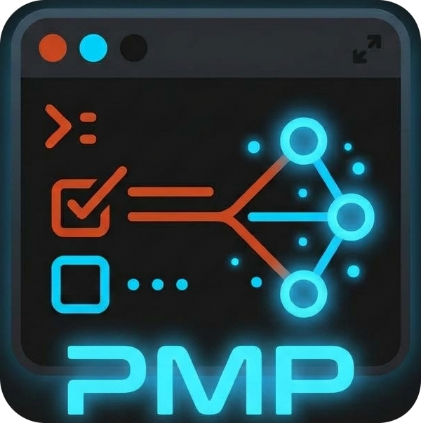

<div align="center">
  
  <h1>🚀 PMP (Project Management Program)</h1>
  <p><strong>Manage your projects and tasks from the terminal with style and efficiency.</strong></p>

  [](LICENSE)
  [](https://www.rust-lang.org/)
</div>

---

## 🌟 What is PMP?

**PMP** is a powerful project management tool designed for developers and terminal lovers. Gone are the days of context-switching between your code editor, the terminal, and a heavy web app to manage your tasks.

With PMP, you get a local, blazing-fast, keyboard-driven project manager powered by a built-in **MCP (Model Context Protocol) Server**.

### What is it for?

- 🗂️ **Organize Projects**: Create, edit, and keep track of all your projects in one place.
- ✅ **Task Management**: Create tasks, assign priorities, statuses (Todo, InProgress, Done), and dependencies between them.
- 🔗 **AI Integration**: Run the built-in MCP server to allow AI assistants to read and update your development status automatically.

---

## ✨ Key Features

- 🖥️ **Elegant TUI (Terminal User Interface)**: Built with `ratatui` for a premium visual experience in your console.
- ⚡ **Fast and Lightweight**: Written in Rust, it consumes minimal resources and responds instantly.
- 🧠 **Built-in MCP Server**: With a simple `pmp mcp` command, the app exposes your projects and tasks via the *Model Context Protocol*, making integration with AI and other modern tools seamless.
- 🔒 **Total Privacy**: All your data is stored locally using SQLite. Your data is yours alone!
- 🔗 **Task Dependencies**: Prevents moving tasks to "Done" if their dependencies haven't been resolved yet.
- 🏷️ **Versions**: Group a project's tasks into versions (for example `v0.2.0`), follow each version's progress, and mark it as released. Tasks and dependencies stay within their version.
- 🧊 **Version Compaction**: Freeze a released version into a summary snapshot; review it from the TUI or export it as Markdown with Mermaid charts.

---

## 🚀 Installation

Install the `pmp` binary with Cargo. You need:

- **Rust 1.85 or newer**, because the project uses edition 2024. [rustup](https://rustup.rs/) is the usual way to get it.
- A **C compiler**, because `rusqlite` builds embedded SQLite: `build-essential` on Linux, Xcode Command Line Tools on macOS, and Visual Studio Build Tools on Windows.

`cargo install --git` uses your active toolchain and does **not** apply `rust-toolchain.toml`. The **1.98.1** pin is for contributors and CI.

### Install with Cargo

```bash
cargo install --git https://github.com/dtorrensf/pmp
```

That installs the `pmp` binary in `~/.cargo/bin`. If you installed Rust with rustup, that directory must be on your `PATH`.

> If `~/.cargo/bin` isn't on your `PATH` it will be necessary to add it.

There are no tags yet.

### Build from a clone (contributors)

```bash
git clone https://github.com/dtorrensf/pmp.git
cd pmp
cargo build --release
```

The binary is `target/release/pmp`.

---

## 💻 How to Use

Using PMP is as simple as typing a command.

### Terminal Interface (TUI)

To open the interactive interface, simply run:

```bash
pmp
```

Use the **arrow keys** to navigate, **Tab** to change statuses or jump between panels, and follow the on-screen keyboard shortcuts to manage your projects. Press **?** on any screen to see the full list of shortcuts.

### Projects and workspaces

Every project can optionally be bound to a directory: the checkout or workspace
the project describes. Set it in the last field of the project form, or through
`create_project` / `update_project` with `working_dir`; the project dashboard
shows it above the description. The path must be absolute and is normalized
(`/srv/repo/../repo` becomes `/srv/repo`), and an empty value clears it.
Projects without one keep working normally: only flows that operate on the
filesystem, such as launching an ACP agent, require it.

### Implementing a task with an agent

From a version's task list, select a task and press **i**. PMP checks that the
task is not done, that every dependency is finished and that the project's
working directory exists; if anything is missing it explains why and launches
nothing. It then starts the configured ACP agent in that directory with the
same implementation prompt the MCP `implement-task` prompt renders, marks the
task **in progress** and shows the streamed updates above the footer.

While the agent works, **Ctrl+x** asks it to stop. When the turn ends, PMP
appends a note with the agent's output and leaves the task in progress: the
final verification and the decision to mark it done stay with you. The agent
profiles come from `[agents.<name>]`; with more than one configured, a picker
asks which one to use.

### Configuration

All settings live in one optional file, `~/.config/pmp/config.toml` (under
`$XDG_CONFIG_HOME` when set):

```toml
[appearance]
palette = "bright"   # default | bright
colors = true        # false keeps shapes and bold only
ascii = false        # ASCII glyph fallback
reduced_motion = false

[appearance.tokens]  # per-token color overrides
accent = "#7aa2f7"

[database]
busy_timeout_ms = 2000
retry_attempts = 5
retry_base_delay_ms = 10
retry_max_delay_ms = 250

[mcp]
timeout_secs = 30    # deadline for one MCP repository operation

[logging]
level = "warn"       # trace | debug | info | warn | error
file = "pmp.log"     # relative to the logs directory; empty disables it

[agents.claude]      # profiles the ACP client can launch
command = "claude-code-acp"
args = ["--stdio"]
env = { ANTHROPIC_API_KEY = "..." }
```

Precedence, lowest to highest: built-in defaults, the legacy `theme.toml`, this
file and, finally, the environment. PMP reads all of it once at startup and
injects the resolved values, so the TUI, the MCP server and the repository never
read the environment themselves. A missing file is normal; a malformed file or
an invalid value is logged and replaced by the previous layer, never fatal. A
zero or negative timeout, an out-of-range retry count, an unknown log level or
an agent profile without a `command` all fall back safely.

#### Inspecting and editing the configuration

`pmp config` reads and writes the same `config.toml` without starting the TUI
or the MCP server:

```bash
pmp config path                       # ~/.config/pmp/config.toml
pmp config list                       # effective values and their source layer
pmp config get logging.level          # debug (config.toml)
pmp config get appearance             # every appearance value
pmp config set logging.level debug    # edit, preserving comments and format
pmp config set agents.claude.command claude-code-acp
pmp config set agents.claude.args '["--stdio"]'
pmp config reset appearance.tokens    # remove one section
```

`list` and `get` show whether each value comes from the defaults,
`config.toml`, the legacy `theme.toml` or an environment variable. `set`
validates with the same rules as the parser (known palettes and tokens, valid
colors, positive integers, valid log levels, `1..=100` retry attempts) and
refuses to rewrite a malformed file. Agent profile `env` tables contain
credentials: they are hidden as `N variable(s) (hidden)` and cannot be edited
through this command; edit `config.toml` directly for those.

#### Appearance and environment

PMP uses the terminal's own ANSI palette, so it adapts to light and dark themes without extra configuration. The appearance values can also come from the environment, which wins over the file:

| Variable | Effect |
| --- | --- |
| `NO_COLOR` | When set to a non-empty value, colors are disabled and only shapes and bold text are used. |
| `PMP_THEME` | Selects a built-in palette: `default` or `bright` (the high-contrast ANSI variants). Unknown names fall back to `default`. |
| `PMP_ASCII` | When set to a non-empty value, the ASCII glyph set replaces the Unicode one, for terminals without Unicode support. |
| `PMP_REDUCED_MOTION` | When set to a non-empty value other than `0`, turns off animations: gauges and bars jump to their value, the in-progress spinner stays still, and toasts appear without sliding. |

```bash
NO_COLOR=1 pmp        # monochrome
PMP_THEME=bright pmp  # high contrast
PMP_ASCII=1 pmp        # ASCII glyphs
PMP_REDUCED_MOTION=1 pmp  # no animations
```

#### Logs

The TUI and `pmp mcp` write one JSON object per line to
`~/.local/share/pmp/logs/pmp.log`. Logs never go to stdout or stderr: those
streams carry the MCP protocol or the TUI screen, so writing there would corrupt
them. The file rotates to `pmp.log.1` when it reaches 4 MiB; `pmp doctor`
reports its path and whether it can be written.

`[logging] level` sets the verbosity and `[logging] file` changes the name
(relative to the logs directory, or an absolute path). `PMP_LOG` and
`PMP_LOG_FILE` override both. An invalid level falls back to `warn`; an empty
file name disables file logging; a log file that cannot be opened never stops
PMP, it just runs without logs.

#### Legacy theme file

`~/.config/pmp/theme.toml` keeps working: its palette is the base and its
`[colors]` overrides are merged below `[appearance.tokens]` from
`config.toml`. To keep a custom palette only for colors, you can still use it:

```toml
palette = "bright"

[colors]
accent = "#7aa2f7"
muted = "dark gray"
```

`palette` accepts `default` or `bright`. Each key in `[colors]` (or
`[appearance.tokens]`) is a semantic token such as `bg`, `text`, `muted`,
`accent`, `success`, `warning`, `danger`, `selection_bg`, `status_done` or
`priority_high`. Colors can be names (such as `dark gray`) or hex values
(`#rrggbb`). `PMP_THEME` takes precedence over both files' palettes. A missing or
malformed file, unknown token names and invalid colors never stop PMP: the
previous layer's values are kept.

### Diagnostics

`pmp doctor` prints what PMP resolved and what it can reach:

```text
$ pmp doctor
pmp doctor 0.6.1

environment
  ok    version: 0.6.1
  ok    platform: linux x86_64
  ok    executable: /usr/bin/pmp

configuration
  ok    config: /home/you/.config/pmp/config.toml
  ok    data: /home/you/.local/share/pmp
  ok    logs: /home/you/.local/share/pmp/logs
  ok    database: /home/you/.local/share/pmp/pmp.db

database
  ok    pmp.db: /home/you/.local/share/pmp/pmp.db (48.0 KiB)
  ok    journal mode: wal (expected wal)
  ok    schema version: 6
  ok    busy timeout: 2000 ms (configured), 5 attempts, 10–250 ms backoff

permissions
  ok    data directory: writable
  ok    logs directory: writable
  ok    config directory: writable

agents
  fail  claude: claude-code-acp not found in PATH

logging
  ok    level: warn (override with PMP_LOG)
  ok    file: /home/you/.local/share/pmp/logs/pmp.log

summary: 15 ok, 0 warn, 1 fail
```

The command only inspects: it does not migrate the database or write logs (the
permission checks create and remove a probe file, and the directories themselves
when missing). It exits `1` when a check fails (an unwritable directory, a broken database, a
missing agent binary) and `0` otherwise, so it can gate scripts. A missing
database or log file is a warning: PMP creates them on first start.

### MCP Server

If you want to integrate PMP with LLM-based assistants or other MCP-compatible applications, run:

```bash
pmp mcp
```

The server will start and interact smoothly with your environment.

#### Shared database and locking

The TUI, the MCP server and agents launched through ACP share one SQLite file
(`pmp.db` in the PMP data directory). PMP opens it in WAL mode and configures a
`busy_timeout`, so a write waits for the lock instead of failing; when the wait
is not enough, transient lock errors are retried with a bounded exponential
backoff, and compound writes run inside `BEGIN IMMEDIATE`. Only a lock that
outlasts the whole budget surfaces as the retryable `db_busy` error. The
`[database]` section tunes the policy, and these environment variables override
it:

| Variable | Default | Effect |
| --- | --- | --- |
| `PMP_DB_BUSY_TIMEOUT_MS` | `2000` | How long SQLite waits for a lock before reporting it as busy. |
| `PMP_DB_RETRY_ATTEMPTS` | `5` | Total attempts per operation, counting the first one. |
| `PMP_DB_RETRY_BASE_DELAY_MS` | `10` | Delay before the first retry; it doubles on every subsequent attempt. |
| `PMP_DB_RETRY_MAX_DELAY_MS` | `250` | Ceiling for the backoff between retries. |
| `PMP_MCP_TIMEOUT_SECS` | `30` | Deadline for one MCP repository operation. |

Invalid values are ignored and the configured (or default) value is kept, so a
typo never prevents the store from opening or the server from starting.

### Error codes

Every failure carries a stable code, shared by the TUI (as the error toast) and
the MCP server (as the `code` field of the error data). A client can react to
the code instead of matching message text:

| Code | Retryable | Meaning |
|---|---|---|
| `not_found` | no | The record does not exist or is not visible. |
| `validation` | no | Input rejected: blank name, oversized text, wrong relationship. |
| `duplicate_name` | no | Another record already uses that name in the same scope. |
| `dependency_blocked` | no | The task has incomplete dependencies; `blockers` lists their ids. |
| `dependency_cycle` | no | The dependency edge would close a cycle. |
| `invalid_transition` | no | The state change is not allowed (for example, moving a task that has edges). |
| `db_busy` | yes | The store is locked; retrying later may succeed. |
| `agent_unavailable` | yes | The configured agent could not be started. |
| `agent_failed` | no | The agent started but the session failed. |
| `internal` | no | Unexpected failure. Details are logged, never sent to clients. |

### Command-line options

```bash
pmp              # Start the interactive TUI
pmp mcp          # Start the MCP server
pmp config       # Inspect or edit config.toml without starting the app
pmp doctor       # Print environment and database diagnostics
pmp --version    # Print version (also -v)
pmp --help       # Print help (also -h)
```

---

## 🤝 Contributing

PMP is a 100% **Open Source** project! We love receiving pull requests, suggestions, and bug reports.

1. Fork the project.
2. Create your feature branch (`git checkout -b feature/NewFeature`).
3. Commit your changes (`git commit -m 'Add New Feature'`).
4. Push to the branch (`git push origin feature/NewFeature`).
5. Open a Pull Request.

---

## 📜 License

This project is licensed under the **AGPL-3.0-or-later** license. This means you are free to use, modify, and distribute the software, provided that any derivative works or modified network services maintain the same license and are open source.

Copyright © 2026 Diego Torréns Farias.

See the [`LICENSE`](LICENSE) file for more details, and [`NOTICE`](NOTICE) for the full copyright notice.

---
<div align="center">
  Made with ❤️ by the Open Source community.
</div>
